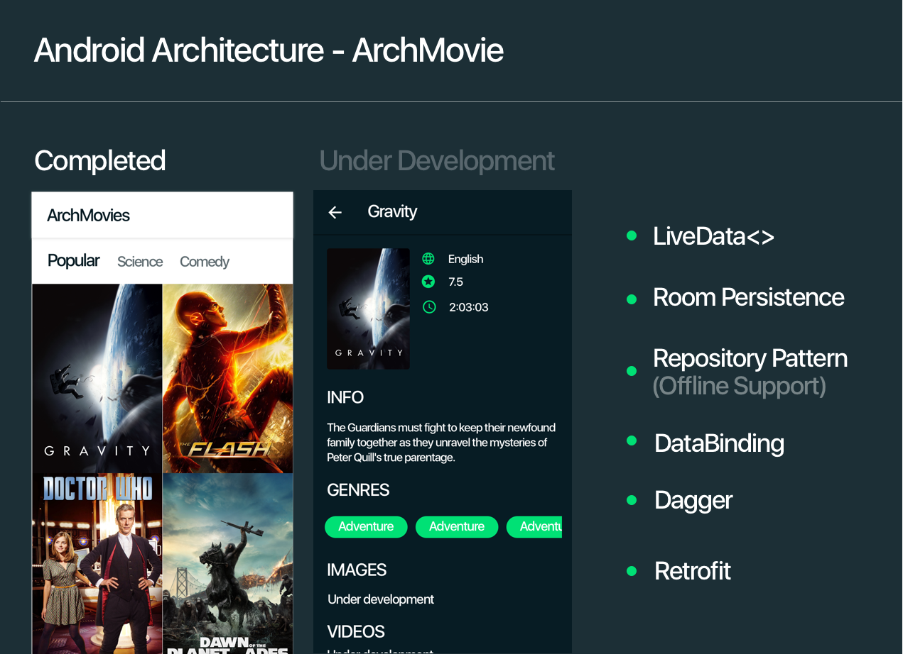
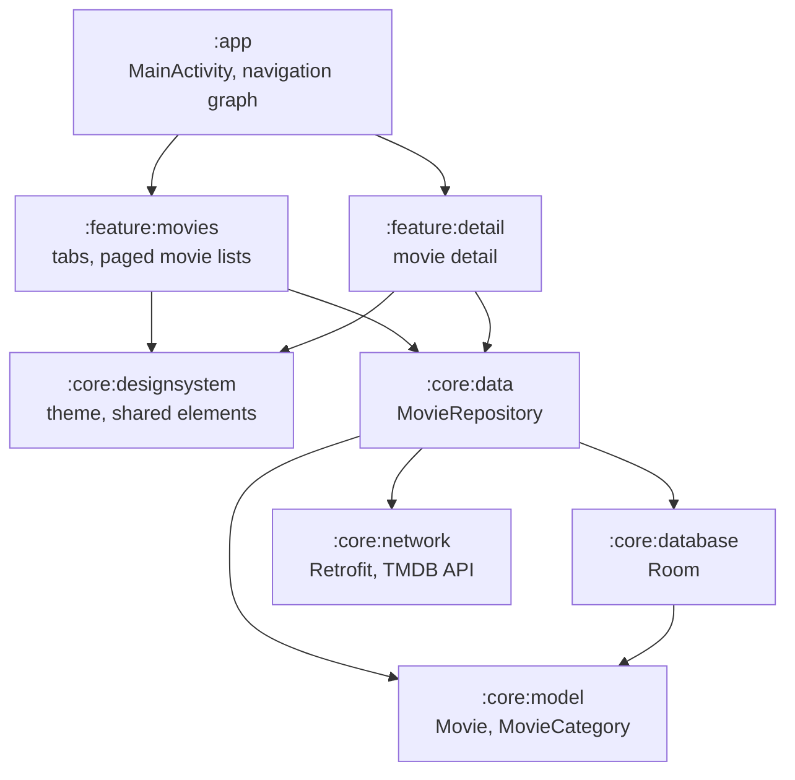

# AndroidArchitecture
Sample app that follows the [recommended Android app architecture](https://developer.android.com/topic/architecture). It shows popular, science fiction and comedy movies from [TMDB](https://www.themoviedb.org/) and works offline with what was loaded before.



The project started in 2017 with LiveData, data binding and dagger-android and was migrated step by step to the current recommendations. The git history shows each step.

## Architecture



- **UI layer**: Jetpack Compose screens with Material 3. Each screen has a view model that exposes its state as a `StateFlow` or `PagingData` and receives events from the screen (unidirectional data flow).
- **Data layer**: `MovieRepository` is offline-first. The Room database is the single source of truth; a Paging 3 `RemoteMediator` loads pages from TMDB into Room and the screens only read from Room.
- **Dependency injection**: Hilt, with assisted injection for the per tab view models.
- **Navigation**: Navigation Compose with type-safe routes. Each feature module exposes its destination as a `NavGraphBuilder` extension and the app connects them.
- **Build**: convention plugins in `build-logic` configure every module, dependencies are declared in `gradle/libs.versions.toml`.

## Libraries

Kotlin, Coroutines and Flow, Jetpack Compose, Material 3, Navigation Compose, Paging 3, Room, Hilt, Retrofit, OkHttp, kotlinx.serialization and Coil. Tests use JUnit, Turbine, Robolectric and the Compose testing APIs.

## Building

Add your [TMDB](https://developer.themoviedb.org/docs/getting-started) API key to `local.properties`:

```
tmdb.apiKey=YOUR_API_KEY
```

Then build and test with JDK 17:

```
./gradlew assembleDebug
./gradlew testDebugUnitTest
```

License
--------


    Copyright 2017 Mert Şimşek.

    Licensed under the Apache License, Version 2.0 (the "License");
    you may not use this file except in compliance with the License.
    You may obtain a copy of the License at

       http://www.apache.org/licenses/LICENSE-2.0

    Unless required by applicable law or agreed to in writing, software
    distributed under the License is distributed on an "AS IS" BASIS,
    WITHOUT WARRANTIES OR CONDITIONS OF ANY KIND, either express or implied.
    See the License for the specific language governing permissions and
    limitations under the License.
